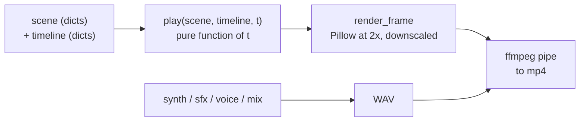

# Sufvid

**Narrated math and physics tutorial videos from plain Python functions.**
No Manim, no AI video generators, no classes: just Pillow, NumPy, SciPy and ffmpeg.


Every frame above was drawn by Sufvid, and every number on screen was **computed** (SciPy ODE solvers, a
neural net trained in NumPy), never faked.

## Why Sufvid

- **A scene is just data.** A list of dicts for the shapes plus a list of dicts for the animations.
- **Everything is a pure function of time.** `render_frame(scene, t)` always returns the same picture for the same
  input, so frames can be rendered in any order (and on 2 CPU cores at once).
- **Real data, real sound.** Draw ODE solutions, field lines and a live-trained neural net. Music, effects and a
  stylised voice are synthesised from math waves.
- **LLM-friendly.** The whole API is 39 functions with consistent names, plus a linter and a self-fixing agent
  loop that lets a language model write videos for you.

## Install

Needs Python 3.10+ and `ffmpeg` on your PATH.

```bash
apt-get install -y ffmpeg                                        # Colab / Ubuntu
pip install git+https://github.com/SUFIYAN2004/SufVid.git
```

To work on the code:

```bash
git clone https://github.com/SUFIYAN2004/SufVid.git
cd SufVid
pip install -e ".[test]"
```

## Quickstart

```python
from Sufvid import *
import numpy as np

ax = axes((-7, 7), (-1.5, 1.5), size=(13, 5), id="ax")
curve = graph(ax, lambda x: np.exp(-abs(x) / 6) * np.sin(x), id="curve")
scene = {"size": (1280, 720), "bg": "#101820", "shapes": [
    text("Hello, Sufvid", pos=(0, 3.8), size=46, font="bold", id="title"), ax, curve]}
timeline = [fade_in("title"), fade_in("ax"), draw("curve", dur=2.0)]
render_video(scene, timeline=timeline, path="hello.mp4")
```

This writes `hello.mp4`: the title fades in, then the axes, then the curve draws itself.

## How it works



- **World coordinates:** units are arbitrary, `y` points up, the origin is the screen centre. At 1280x720 with the
  default view you see x from -8 to 8 and y from -4.5 to 4.5.
- **Pixels:** stroke widths and text sizes are in output pixels.
- **Ids:** give a shape an `id=` and a timeline entry can target it. A shape that `fade_in`, `draw` or `type_text`
  targets stays hidden until its animation starts.
- **Timing:** `at=None` runs after the previous animation, `at="with"` runs together with it, `at=2.5` starts at
  2.5 seconds.

## Draw real data

```python
from Sufvid import *
import numpy as np

sim = simulate("projectile", v0=20, angle=50, drag=0.15)         # solved with SciPy, not a formula
T = float(sim["t"][-1])                                          # flight time in seconds
ax = axes((0, 45), (0, 14), size=(13, 5.4), x_step=5, y_step=2, id="ax")
path = np.column_stack(axes_point(ax, sim["pos"][:, 0], sim["pos"][:, 1]))
scene = {"size": (1280, 720), "bg": "#101820", "shapes": [
    ax,
    graph(ax, xs=sim["pos"][:, 0], ys=sim["pos"][:, 1], id="arc"),
    circle(tuple(path[0]), 0.15, fill="#ffd60a", id="ball"),
]}
timeline = [fade_in("ax"),
            draw("arc", dur=T, easing="linear"),
            follow_path("ball", path, at="with", dur=T, easing="linear")]   # the ball rides the same samples
render_video(scene, timeline=timeline, path="projectile.mp4")
```

## Add sound

Sound is placed on the same clock as the animation. `mix` returns the samples and can also write a WAV file, and
`render_video(..., audio=...)` adds it to the mp4.

```python
from Sufvid import *

scene = {"size": (1280, 720), "bg": "#101820", "shapes": [
    text("Sound is just math", pos=(0, 0), size=54, font="bold", id="title")]}
timeline = [fade_in("title", dur=0.5)]
audio = mix([(0.0, sfx("whoosh")),
             (0.6, voice("sound is just math")),            # stylised blip voice, pure NumPy
             (2.0, sfx("success"))], path="sound.wav")
render_video(scene, timeline=timeline, audio="sound.wav", path="sound.mp4")
```

## API reference

Everything below comes from `from Sufvid import *`. Use `help(name)` for the details of each function.

| Group | Functions |
| --- | --- |
| Colors, math | `with_alpha` `mix_colors` `lerp` `remap` `clamp` `ease` |
| Shapes | `circle` `line` `rect` `arrow` `polygon` `text` `mathtext` `axes` `axes_point` `graph` `heatmap` `points` |
| Animations | `fade_in` `fade_out` `move_to` `draw` `type_text` `follow_path` `wait` |
| Timeline | `play` `timeline_duration` |
| Real data | `simulate` (projectile, pendulum, spring) `field_lines` `train_mlp` |
| Audio | `synth` `sfx` `voice` `mix` |
| Render | `render_frame` `save_png` `render_video` |
| Agent | `check_scene` `agent_loop` |

## Let an AI write the video

`agent_loop(task, generate)` asks a language model for a program, **lints** it with `check_scene`, previews frames,
renders it, and sends every error back to the model until it works. `generate` is any function from prompt to reply.

```python
from Sufvid import agent_loop
from Sufvid.agent.docs import build_docs

def generate(prompt):              # plug in any LLM here: prompt (str) -> reply (str)
    ...

result = agent_loop("A 20-second tutorial on a damped spring-mass oscillator, using real simulation data.",
                    generate, max_tries=5, path="out.mp4",
                    docs=build_docs(examples=["projectile_real_data", "pendulum_scene_function"]))
print(result["ok"], result["attempts"])
```

`check_scene` catches problems before any rendering: unknown ids, `draw` on the wrong shape, text overlapping text
(at any moment, even while it moves or types), text cut off by the frame edge, and shapes completely off-screen.

- **Open-weights model on a free Colab T4:** open `examples/Sufvid_agent_open_model.ipynb`. It loads
  Qwen2.5-Coder-7B-Instruct in 4-bit and plugs it into the loop. It needs a GPU, so it is not part of the tests.
- **Hosted model:** see `examples/demo_agent_real_llm.py`.
- **Prompt text:** `build_docs()` generates what the model sees (rules, API, working examples) from the real code.

> Model-written code is executed **without a sandbox**. Use a throwaway environment.

## Optional neural voice

The default voice is a stylised blip voice built from NumPy math: rhythmic, but **not intelligible as words**.
For understandable speech, `voice(text, engine="piper")` uses the external [Piper](https://github.com/rhasspy/piper)
program, which is not NumPy-generated:

```python
import os
os.environ["PIPER_BIN"] = "/path/to/piper/piper"                 # the piper executable
os.environ["PIPER_MODEL"] = "/path/to/en_US-lessac-medium.onnx"  # a Piper voice (its .json sits next to it)
```

Results are cached on disk, so a line is generated once and then reused. Voices have their own licences, so check
before publishing a video.

## Project layout

```text
src/Sufvid/
  core/      colors, easing, interpolation, world-to-pixel transform
  shapes/    circle, line, rect, arrow, polygon, text, mathtext, axes, graph, heatmap, points
  anim/      animation constructors and the timeline that evaluates them at any time t
  physics/   ODE systems (SciPy) and electric field lines
  nn/        a small neural net in NumPy (hand-written backprop)
  audio/     oscillators, envelopes, sound effects, voice, mixer
  render/    render_frame and the ffmpeg-pipe video encoder
  agent/     linter, prompt docs, example programs, the self-fixing loop
examples/    demo scripts and the Colab notebook
tests/       pytest wrapper around the check scripts
```

## Tests

```bash
pytest -q        # runs against the installed package; needs ffmpeg
```

## Known limits

- Video rendering uses `fork`, so it works on Linux, macOS and Colab. On Windows pass `workers=1`.
- Speed: simple 720p scenes render at roughly 20-30 frames per second on 2 CPU cores, so a 3-minute video takes
  a few minutes. Frames are drawn at 2x and downscaled for smooth edges.
- Text is single-line only. The linter checks text against text and against the frame edge, not text against
  other shapes.
- Square and saw waves alias slightly at high pitch: fine for tutorials, not for studio music.

## License

No license has been chosen yet. Add a `LICENSE` file before sharing or accepting contributions.
